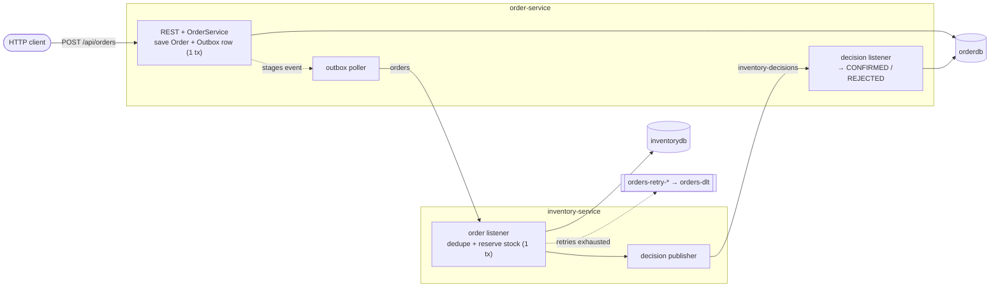
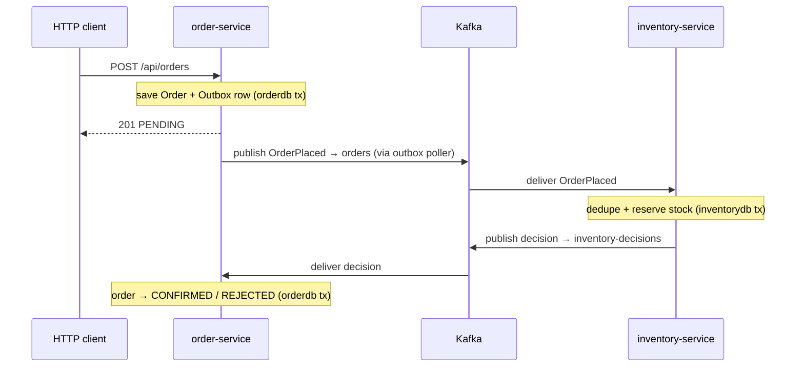

# Event-Driven Microservices: Spring Boot 4 + Kafka

Two services that talk **only through Kafka**, built to show the patterns that
matter once failures are real: **transactional outbox**, **idempotent consumer**,
**non-blocking retries + dead-letter topic**, a **choreographed saga**,
**database-per-service**, and **tracing across the Kafka hop**.

Stack: Spring Boot 4.0 · Java 25 · Spring for Apache Kafka 4.0 · Kafka in KRaft
mode (no ZooKeeper) · Testcontainers 2. Everything here is run-verified.

---

## 1. Flow

A customer places an order. `order-service` saves it and emits `OrderPlaced`.
`inventory-service` reserves stock and emits a decision. `order-service` applies
that decision → `CONFIRMED` / `REJECTED`. No HTTP between services — only events,
so either can be down or slow and the system still converges.



Separate database per service. Topics: `orders`, `inventory-decisions`, plus
`orders-retry-1000/2000/4000` and `orders-dlt` (auto-created on retry).

---

## 2. Layout

```
kafka-microservices-demo/
├── compose.yaml            # Kafka (KRaft) + Kafka-UI + DbGate + a Postgres per service
├── api.http                # ready-to-fire requests
├── order-service/          # command side — REST in, events out, saga completion
└── inventory-service/      # reaction side — events in, stock + decisions out
```

Two **independent Maven projects** (own `pom.xml`, own `mvnw`). They share only
the event shapes on the wire — and each keeps a private copy of those (§9).
Packages in each service: `web` → `service` → `domain` / `repository` →
`event` → `messaging` → `config`.

---

## 3. Run

**Prerequisites:** Java 25, Docker. Kafka and Postgres run in containers.

```bash
# 1. infra (once)
docker compose --profile order --profile inventory up -d

# 2. the services, in two terminals
cd order-service     && ./mvnw spring-boot:run     # → http://localhost:8081
cd inventory-service && ./mvnw spring-boot:run     # → http://localhost:8082
```

Start infra first: both apps target the same Compose project, so cold-starting
them at once races on creating the Kafka container (§9). With infra already up
they just attach (`spring.docker.compose.lifecycle-management=start-only`).

UIs that come up with the infra:
- **Kafka-UI** → http://localhost:8090 — topics, messages, groups, lag
- **DbGate** → http://localhost:8091 — `orderdb` and `inventorydb` pre-wired, no login

Stop: `Ctrl-C` the services; `docker compose down` for the infra.

---

## 4. Watch it work

`api.http` has these ready; or curl:

```bash
# Confirmed — returns 201 PENDING instantly, flips to CONFIRMED a beat later
curl -s -XPOST localhost:8081/api/orders -H 'Content-Type: application/json' -d '{"productCode":"WIDGET","quantity":2}'
curl -s localhost:8081/api/orders/<id>          # → "status":"CONFIRMED"

# Rejected — not enough stock (only 5 GADGETs)
curl -s -XPOST localhost:8081/api/orders -H 'Content-Type: application/json' -d '{"productCode":"GADGET","quantity":999}'   # → REJECTED

# Rejected — unknown product
curl -s -XPOST localhost:8081/api/orders -H 'Content-Type: application/json' -d '{"productCode":"NOPE","quantity":1}'       # → REJECTED

# Poison pill — BOOM throws every time → retried with backoff → dead-letter topic
curl -s -XPOST localhost:8081/api/orders -H 'Content-Type: application/json' -d '{"productCode":"BOOM","quantity":1}'
```

The `BOOM` order is retried on delayed topics, then parked — it stays `PENDING`,
never lost:

```
Received order …   (attempt 1 — orders)
Received order …   (attempt 2 — orders-retry-1000)   ~1s
Received order …   (attempt 3 — orders-retry-2000)   ~2s
Received order …   (attempt 4 — orders-retry-4000)   ~4s
DEAD LETTER: order event exhausted retries. origin-topic=orders, error='…BOOM…'
```

Seed data ([`DataInitializer`](inventory-service/src/main/java/com/example/inventoryservice/config/DataInitializer.java)):
`WIDGET` 100, `GADGET` 5, `GIZMO` 0; `BOOM` is unseeded and throws.

---

## 5. The patterns

### 5.1 Database per service
`order-service` → `orderdb`, `inventory-service` → `inventorydb`; neither reads
the other's tables. A shared DB makes them a distributed monolith. The price — no
cross-service `JOIN`, no single ACID transaction across both — is exactly why the
next two patterns exist. Compose profiles (`order`/`inventory`) give each its own
Postgres container.

### 5.2 Transactional outbox ⭐
`order-service` must save the order **and** publish an event. Naively:

```java
orderRepository.save(order);          // commits to Postgres
kafkaTemplate.send("orders", event);  // ...crash here → event lost
```

Two systems, no shared transaction — the **dual-write problem**, unsolvable while
writing to both at once. The outbox writes to **one** system: in the same DB
transaction as the order, insert an outbox row.

```java
@Transactional
public OrderEntity placeOrder(String productCode, int quantity) {
    orders.save(order);
    outbox.save(new OutboxEvent(... topic="orders", payload=json(event) ...));
    return order;                      // both commit, or neither does
}
```
([`OrderService`](order-service/src/main/java/com/example/orderservice/service/OrderService.java)) —
no Kafka call here. A scheduled [`OutboxPoller`](order-service/src/main/java/com/example/orderservice/messaging/OutboxPoller.java)
ships unpublished rows and marks them sent only after the broker acks. Crash
before the send → re-sent next poll; crash after → sent again. At-least-once,
which is fine because the consumer is idempotent (§5.3).

> Production: swap the poller for **Debezium** CDC reading the outbox table from
> Postgres's WAL.

### 5.3 Idempotent consumer = effectively-once
At-least-once delivery means the same event can arrive twice; the consumer must
*act* once. An idempotency ledger:

```java
@Transactional
public Optional<InventoryDecisionEvent> reserve(OrderPlacedEvent event) {
    if (processedEvents.existsById(event.eventId())) return Optional.empty(); // seen it
    ... reserve stock ...
    processedEvents.save(new ProcessedEvent(event.eventId()));                // record it
    return Optional.of(decision);
}
```
([`InventoryService`](inventory-service/src/main/java/com/example/inventoryservice/service/InventoryService.java))

Check, stock decrement, and "seen it" share one transaction. A duplicate finds
its `eventId` and skips. The producer assigns `eventId` (stable across
redeliveries). **At-least-once + idempotent consumer = effectively exactly-once** —
the only exactly-once that's real.

### 5.4 Non-blocking retries + dead-letter topic
Transient failures deserve a retry, but a *blocking* retry stalls the whole
partition behind one record. `@RetryableTopic` forwards the record to a delayed
retry topic and moves on; after N attempts it lands in the DLT.

```java
@RetryableTopic(attempts = "4", backOff = @BackOff(delay = 1000, multiplier = 2.0))
@KafkaListener(topics = "orders", groupId = "inventory-service")
public void onOrder(String payload) { ... }

@DltHandler
public void onDlt(String payload, @Header(KafkaHeaders.ORIGINAL_TOPIC) String topic, ...) { ... }
```
([`OrderEventListener`](inventory-service/src/main/java/com/example/inventoryservice/messaging/OrderEventListener.java))

Trade-off: non-blocking retries **break per-partition ordering**. If ordering
beats throughput, use blocking retries (`DefaultErrorHandler` +
`DeadLetterPublishingRecoverer`).

> Business rejections (no stock, unknown product) **don't throw** — they publish a
> `REJECTED` decision. Only transient faults throw, so only they retry. Throwing on
> a business outcome would retry the unretriable and flood the DLT.

### 5.5 Choreographed saga
No distributed transaction — a saga of local transactions, each triggered by the
previous one's event.



**Choreography** (no coordinator, services react to events) suits short flows;
**orchestration** (a central coordinator) scales to long, branchy ones.
Compensation here is trivial (`REJECTED`); richer flows need an explicit
compensating action per step.

---

## 6. Tracing across the Kafka hop

Actuator and Micrometer tracing are on; each record carries a `traceparent`
header, so a flow shows up as one trace across both services. From real logs:

```
order-service     [order-service,6a1aaf58…0b18,…] Placed order 522a… (event c90e… staged in outbox)
inventory-service [inventory-service,6a1aaf58…6761,…] Received order 522a…
inventory-service [inventory-service,6a1aaf58…6761,…] reserved WIDGET x1 (93 left)
order-service     [order-service,6a1aaf58…6761,…] Received decision RESERVED for 522a…
```

The consumer work and order-service's decision handling share `…6761` — the trace
crossed Kafka. The HTTP `Placed order` line has a **different** trace (`…0b18`):
the outbox poller publishes on its own thread, so the request's trace doesn't
reach the consumer. Reliability and tracing pull against each other — stash
`traceparent` in the outbox row to bridge it. Add `spring-boot-starter-zipkin`
plus a Zipkin container to visualize.

---

## 7. Tests

Each service boots its full context against real Postgres + Kafka in
Testcontainers via `@ServiceConnection` — which *does* support Kafka, unlike
Docker Compose (§9, last bullet).

```bash
./mvnw test
```

---

## 8. Deliberately left simple

- **Single broker, RF 1** — laptop only; prod wants ≥3 brokers, `replication.factor=3`, `min.insync.replicas=2`.
- **`ddl-auto=update`** — Hibernate makes the tables; prod uses Flyway/Liquibase + `validate`.
- **Consumer-side dual write — the one real gap, left in on purpose.** `inventory-service` commits stock, *then* publishes the decision in a separate step — not atomic. Crash in between and the redelivery is skipped by the idempotency check (decision never re-published); a silent publish failure commits the offset and the decision is simply lost. Either way the order is stuck `PENDING`, and nothing watches for that. It's the §5.2 dual-write problem, unguarded here to contrast with the outbox. Fix: give inventory-service its own outbox (or the replay below, or a reconciliation sweep).
- **Dedupe skips, doesn't replay** — storing the decision on `processed_event` and re-emitting it on a duplicate would self-heal a lost publish.
- **No security** — prod wants TLS/SASL on Kafka and authn/authz on the API.
- **Contract is duplicated JSON, not a schema** — each service owns its copy; prod uses a schema registry (Avro/Protobuf) to enforce compatibility at build time. JSON-as-text is also what makes the outbox a trivial column.
- **`spring-boot-docker-compose` + Kafka** — Postgres is auto-wired; Kafka is **not** ([#35140 declined](https://github.com/spring-projects/spring-boot/issues/35140)), so Compose only manages Kafka's lifecycle and we set `spring.kafka.bootstrap-servers` ourselves. Both apps share one Compose project, so cold-starting them together races on the Kafka container — start infra first (§3).

---

## 9. Reference

- [Spring Kafka — Non-Blocking Retries](https://docs.spring.io/spring-kafka/reference/retrytopic.html)
- [Spring Kafka — Error Handling / DLT](https://docs.spring.io/spring-kafka/reference/kafka/annotation-error-handling.html)
- [microservices.io — Transactional Outbox](https://microservices.io/patterns/data/transactional-outbox.html)
- [Confluent — Idempotent Reader](https://developer.confluent.io/patterns/event-processing/idempotent-reader/)
- [Spring Boot — Docker Compose service connections](https://docs.spring.io/spring-boot/reference/features/dev-services.html)
